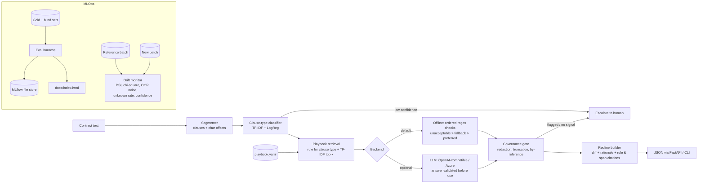

# Contract Redline Copilot

**Playbook-grounded contract review with an evaluation and drift harness.**

Producing *a* redline is easy. Producing one a company's lawyers will accept is hard: the edit has
to follow that company's own playbook (its preferred positions, its acceptable fallbacks, the
terms it never accepts, and its approved wording) and it has to be traceable, so a reviewer can
see which rule drove the edit and which words in the contract triggered it. If a reviewer spends
the time saved fixing over-eager or ungrounded edits, the tool has not helped.

This project is a small, end-to-end take on that problem for enterprise legal teams:

* **Playbook as data.** Eight clause types in [`playbook/playbook.yaml`](playbook/playbook.yaml),
  each with preferred / fallback / unacceptable positions, approved redline language, and
  machine-checkable signals.
* **Grounded redlines.** Every proposed edit is a word-level diff, cites the playbook rule and check
  ID, and points at the exact character span in the source contract that triggered it.
* **Don't over-redline.** Fallback positions are accepted, with at most an *optional* suggestion.
  Only unacceptable terms get a required replacement.
* **Abstain, don't guess.** Uncertain clause types, redacted terms, clauses cut off at a page
  break, terms incorporated by reference, and clauses no rule signal covers are escalated to a
  human.
* **Measured.** A hand-labeled gold set built from real CUAD contracts, a separate blind set, MLflow
  run tracking, and a drift / data-quality monitor for incoming batches.

Everything runs offline with no API keys. An optional LLM backend sits behind the same interface.

> Portfolio project. Not legal advice, not used in production, and not reviewed by a lawyer.

## Architecture



| Module | Role |
|---|---|
| `segment.py` | Splits EDGAR-style contract text into clauses, keeping offsets into the original. |
| `classifier.py` | TF-IDF (word + char n-grams) + logistic regression over 9 labels (8 playbook types + `other`). |
| `playbook.py` | Loads the YAML, compiles checks, retrieves rules by clause type and by TF-IDF similarity. |
| `assess.py` | Governance gate + ordered checks → `compliant` / `fallback` / `non_compliant` / `needs_human`. |
| `redline.py` | Builds the edit (`none` / `suggest` / `replace`), the inline diff, and the citations. |
| `backends.py` | `OfflineBackend` (default) and `LLMBackend` (OpenAI-compatible or Azure OpenAI). |
| `pipeline.py` | Ties it together for one clause or a whole document. |
| `evaluate.py` | Metrics + MLflow logging. |
| `drift.py` | Batch profiling, PSI / chi-square, noise and unknown-clause rates, shift injection for the demo. |
| `api.py`, `cli.py`, `report.py` | FastAPI service, `redline` CLI, static HTML report. |

## Quickstart

```bash
python -m venv .venv && source .venv/bin/activate
pip install -e ".[dev,mlops]"

pytest -q                       # 38 tests, fully offline
redline eval --mlflow           # dev gold set, logs a run to ./mlruns
redline eval --gold data/gold/blind.jsonl --name blind --mlflow
redline drift                   # clean new batch vs reference  -> OK
redline drift --inject-shift    # OCR-corrupted, skewed batch   -> ALERT
redline report --mlflow         # all of the above + docs/index.html
redline review data/cuad/contracts/new/<file>.txt

uvicorn redline.api:app --port 8000
curl -s localhost:8000/review -H 'content-type: application/json' \
  -d '{"text":"This Agreement shall be governed by the laws of England and Wales."}'
```

Abridged response:

```json
{
  "clause_type": "governing_law", "risk": "non_compliant",
  "retrieved_rules": [{"rule_id": "GOV-01", "score": 0.4547}, "..."],
  "redline": {
    "action": "replace",
    "diff": "This Agreement shall be governed by {+and construed in accordance with+} the laws of [-England-]{+the+} ...",
    "rationale": "GOV-01 (Governing law): Non-U.S. governing law. The playbook lists this as unacceptable, ...",
    "citations": [{"rule_id": "GOV-01", "check_id": "GOV-01.U1",
                   "clause_span": {"start": 0, "end": 66},
                   "evidence_span": {"start": 40, "end": 55, "quote": "laws of England"}}]
  }
}
```

Docker: `make docker-build && make docker-run` (the image runs the offline backend).

### Optional LLM backend

```bash
export REDLINE_BACKEND=llm
export REDLINE_LLM_PROVIDER=openai          # or azure
export REDLINE_LLM_BASE_URL=https://api.openai.com/v1
export REDLINE_LLM_API_KEY=...
export REDLINE_LLM_MODEL=gpt-4o-mini        # Azure: deployment name
```

The model gets the clause and the single retrieved rule and must answer in JSON. Its answer is
**validated, not trusted**: an unknown risk label, or an evidence quote that is not a verbatim
substring of the clause, escalates to a human. A replacement that drops the approved language is
discarded in favour of the playbook text. The deterministic governance gate runs before any model
call. Any gateway that speaks the OpenAI chat API (for example a Bedrock proxy) works through
`REDLINE_LLM_BASE_URL`; there is no native Bedrock client. Tests cover the request shape and
validation with a mocked HTTP transport. The LLM backend has **not** been evaluated against a live
model (see Limitations).

## Data

* **Source:** [CUAD v1](https://www.atticusprojectai.org/cuad) (510 commercial contracts from SEC
  EDGAR with expert clause annotations), downloaded from
  [Zenodo](https://zenodo.org/records/4595826). `scripts/build_cuad_subset.py` rebuilds the shipped
  subset from the official zip.
* **Split:** contracts are split ~90/10 by a hash of the title. Training clauses and gold clauses
  never come from the same contract.
* **Training labels (weak):** a segment takes a clause type when it overlaps a CUAD expert span of a
  mapped category (e.g. *Cap On Liability* → `limitation_of_liability`). CUAD has no
  indemnification or confidentiality category, so those two use a heading rule. 1,755 training
  clauses, capped at 220 per class.
* **Gold sets (hand-labeled by the project author, not a lawyer):**
  * `data/gold/gold.jsonl` (**dev**): 69 held-out clauses (61 in playbook scope, 8 `other`). Clause
    type starts from CUAD and is corrected where a segment is really another type. Risk labels
    were assigned by reading each clause against the playbook's prose positions, *before* the
    regex checks were written. The checks were then written and adjusted with these clauses in
    view, so dev numbers are optimistic.
  * `data/gold/blind.jsonl` (**blind**): 24 more held-out clauses, labeled *after* the checks were
    frozen and never used for tuning. This is the honest estimate, and it is small.

## Results (offline backend, measured)

Produced by `redline report --mlflow`. Raw outputs are in `reports/` and the rendered page is
`docs/index.html`.

| Metric | Dev (n=69) | Blind (n=24) |
|---|---:|---:|
| Clause-type accuracy | 0.942 | 0.958 |
| Risk-label macro-F1 (compliant / fallback / non-compliant / needs-human) | 0.818 | 0.603 |
| Risk-label accuracy (in-scope clauses: 61 / 21) | 0.853 | 0.619 |
| Redlines proposed | 30 | 10 |
| Redline acceptability (rubric, all four checks pass) | 0.967 | 0.800 |
| Required-redline recall (non-compliant clauses that got a replacement) | 0.833 | 0.667 |
| Over-redlines (replacement on a clause gold marks acceptable) | 1 | 1 |
| Citation correctness | 0.979 | 1.000 |
| Abstention (escalation) rate | 0.203 | 0.292 |
| Escalation precision / recall vs gold `needs_human` | 0.357 / 1.000 | 0.286 / 0.667 |
| Mean latency per clause (CPU, offline) | 4.5 ms | 3.4 ms |

Classifier alone, 5-fold cross-validation grouped by contract on the weak training labels
(`scripts/cv_classifier.py`): accuracy 0.890, macro-F1 0.890 (n=1,755).

**Drift demo** (`redline drift`): reference = 16 training contracts, new = 8 held-out contracts.

| Batch | PSI (clause mix) | Chi-square p | OCR/encoding-noise rate | Status |
|---|---:|---:|---:|---|
| Clean new batch | 0.029 | 0.55 | 0.000 (ref 0.004) | OK |
| Injected shift (OCR corruption + liability-heavy mix) | 0.802 | 6.8e-16 | 0.391 | **ALERT** |

The unknown-clause and mean-confidence checks did not fire on the shifted batch. The injected shift
removes many hard-to-classify boilerplate segments, so confidence went *up*. A monitor needs
several signals because a single one can miss a real shift.

### Metric definitions

* **Risk macro-F1** is the mean F1 over the four risk labels. A clause the pipeline does not review
  counts as a miss.
* **Redline acceptability** is an automated rubric applied to each proposed edit. (1) It cites the
  rule for the gold clause type. (2) It contains the approved (or fallback) language verbatim. (3)
  It preserves meaning: a `suggest` keeps the original wording intact, and a `replace` must be
  re-classified as the same clause type. (4) It is warranted: gold says non-compliant for
  `replace`, fallback for `suggest`. For the offline backend, checks 1–3 hold by construction, so
  the informative part is (4). The rubric exists mainly to gate the LLM backend. It is a proxy and
  not a lawyer's judgement.
* **Citation correctness:** the cited rule matches the gold clause type, the clause span equals
  the gold offsets, and the evidence quote equals the source text at its offsets.

## Limitations

* **Small, single-annotator gold sets.** The labels are mine, not a lawyer's. On a 24-clause blind
  set, one clause moves accuracy by about 4 points, so treat the blind numbers as rough.
* **Regex checks are brittle.** The dev/blind gap (risk macro-F1 0.82 → 0.60) is the honest
  signal. Phrasings the checks did not anticipate either escalate or get misread. For example,
  "unless earlier terminated" hides a no-opt-out auto-renewal, and a forum-dependent Illinois/New
  York clause matched the New York signal.
* **Clause boundaries.** EDGAR page breaks split clauses, and the segmenter does not join them back.
  Those clauses are escalated rather than assessed.
* **Perspective.** The playbook is balanced (it favours mutual terms) because it does not know
  which side the reviewer represents. A real deployment would take the client's side as input.
* **Termination for cause vs convenience** is a known confusion. In full-document review, a
  "termination for cause" section can be classified as termination for convenience.
* **Weak training labels** for indemnification and confidentiality (heading rule) add label noise.
* **Not run here:** the LLM backend against a live model, the Docker build, and the GitHub Actions
  workflow. They are written and the LLM path is unit-tested with a mocked transport, but there
  are no measured LLM numbers.

## Project layout

```
playbook/playbook.yaml          company playbook (8 rules)
src/redline/                    package (see table above)
data/cuad/train_clauses.jsonl   weakly labeled training clauses (CUAD-derived)
data/cuad/heldout_candidates.jsonl  held-out segment pool the gold sets were drawn from
data/cuad/contracts/{reference,new}/  full CUAD contract texts for the drift demo
data/gold/{gold,blind}.jsonl    hand-labeled evaluation sets
scripts/                        CUAD subset builder, classifier cross-validation
reports/                        eval + drift JSON from the last run
docs/index.html                 static eval report (GitHub Pages ready)
tests/                          pytest suite (offline)
```

## License and attribution

Code: MIT (see `LICENSE`).

Contract text and the annotations the labels derive from come from the **Contract Understanding
Atticus Dataset (CUAD) v1** by The Atticus Project, licensed under
[CC BY 4.0](https://creativecommons.org/licenses/by/4.0/). Hendrycks, Burns, Chen and Ball, *CUAD:
An Expert-Annotated NLP Dataset for Legal Contract Review* (NeurIPS 2021 Datasets and Benchmarks).
Changes: contracts were segmented into clauses, a subset was selected, CUAD categories were mapped
to this project's clause types, and new risk labels were added by the project author. See
[`data/README.md`](data/README.md).
